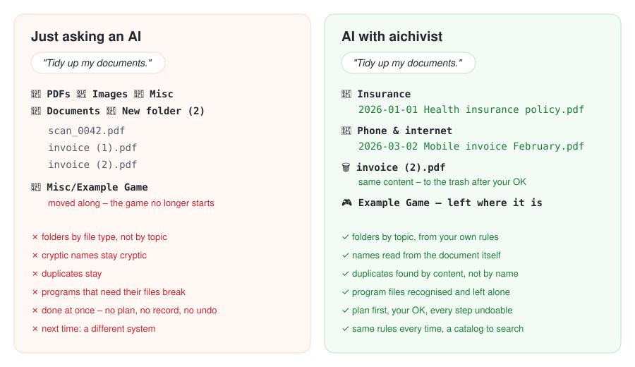
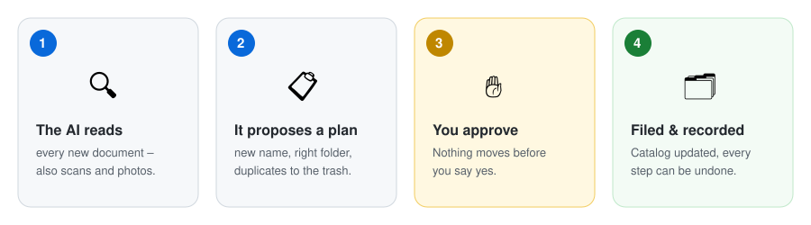
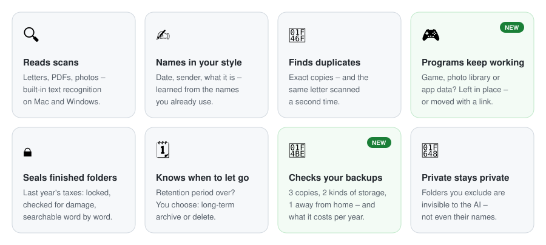

<div align="center">


# aichivist

### Clean up your files – like an archivist.

**Your AI renames, sorts and de-duplicates your documents.<br>You approve every step, and everything can be undone.**

[](https://github.com/luftphilipp/aichivist/actions/workflows/tests.yml)


[Get started](#get-started) · [Why not just ask an AI?](#why-not-just-ask-an-ai) · [What it can do](#what-it-can-do)

</div>

## Why not just ask an AI?

Tell ChatGPT or Claude *"tidy up my documents"* and you usually get a quick job: folders by file type
(`PDFs`, `Images`, `Misc`), the same cryptic names, duplicates left where they were – and sometimes a game or program
that no longer starts because its files were moved. It happens all at once, with no plan to check and no way back.
Next time, the AI invents a different system.



aichivist gives your AI what a professional archivist works with: **your own filing rules**, a **plan you approve**,
**names read from the document itself**, **duplicates found by content**, **programs that keep working**, and a
**record of every step** that can be undone. Tried in real use on 25,000 photos and 1,500 documents.

## How it works



- **Nothing happens without your OK.** You see the plan first and can change or strike any line.
- **Nothing gets lost.** Every step is recorded and can be undone; duplicates go to the trash only after you agree.
- **Your files stay yours.** Normal folders, your own cloud, no account, no server.
- **Speaks your language.** Messages in English or German; rule templates in English, German, French, Italian and
  Spanish.

## What it can do



## Get started

**Claude Desktop** – the easiest way, no technical knowledge needed
1. Download the `.mcpb` file from the [latest release](https://github.com/luftphilipp/aichivist/releases/latest)
   (no Claude Desktop yet? [claude.ai/download](https://claude.ai/download)).
2. Double-click it and choose the folders Claude may organize.
3. Ask Claude: *"Tidy up my Downloads."*

<details>
<summary>Other ways: Claude Code, Codex/Gemini CLI/Cursor, or without AI</summary>

**Claude Code** – type `/plugin marketplace add luftphilipp/aichivist`, then `/plugin install aichivist@aichivist`,
then say *"Set up aichivist."* The setup installs the command-line tool if it is missing (it asks first).

**Codex, Gemini CLI, Cursor** – `pipx install aichivist` (or `uv tool install aichivist`), then copy
[`templates/AGENTS.md`](templates/AGENTS.md) to where your agent reads instructions.

**Downloaded the ZIP?** Unpack it and double-click **`Start (Mac).command`** or **`Start (Windows).bat`**
(Linux: `start.sh`). A simple menu opens – look at your Downloads, check your backups, and see which AI app on your
computer can tidy up. No installation needed, only Python 3 (a new Mac offers to install it by itself).
The first time, your computer warns because the file comes from the internet:
- **Mac:** click *Done*, open *System Settings → Privacy & Security*, scroll down and click *Open Anyway* next to
  "Start (Mac).command", then confirm.
- **Windows:** click *More info → Run anyway*.

</details>

**Just curious?** See what's going on in your folders – no AI, nothing is changed:

```bash
pipx install aichivist
aichivist survey ~/Downloads
```

It shows how many files you have, duplicates that waste space, files with meaningless names, folders that slow down
your cloud, program folders to leave alone, and whether your hard drive is healthy. `aichivist storage storage.md`
checks whether your backups are safe and what your storage costs per year (it shows the table format on first run).
`aichivist catalog-page <folder> --open` turns your catalogs into a searchable page, `aichivist photos` sorts photos
by year, and `aichivist watch ~/Downloads --install` reminds you once 25 files have piled up.

<details>
<summary>See it in action (terminal demo)</summary>



</details>

## Built on real archive practice

Archives have organized documents reliably for centuries. aichivist brings their rules to your computer:

| In an archive | In aichivist |
|---|---|
| A **filing plan** says where everything belongs | Your rules say which documents go where – the AI follows them |
| **Nothing is thrown away** without a decision | Duplicates and old files are only removed after your OK |
| Every document is **described in a catalog** | Each folder gets a list of what is in it, so you find things later |
| **Finished collections are sealed** | A completed folder (e.g. last year's taxes) is locked, checked and searchable |
| Records are **kept for a set time**, then archived or destroyed | Old records come up when their time is over – you choose |
| **Copies are kept in separate places** | It checks the 3-2-1 rule: 3 copies, 2 kinds of storage, 1 away from home |

## Privacy

aichivist itself works only on your computer. The AI that reads your documents (e.g. Claude) receives the content of
the documents it reads – so you decide which folders it may open, and can exclude private ones completely.

## How this was built

aichivist was designed by **Philipp Luft**, a trained archivist and information professional (Fachmann Information &
Dokumentation) studying Business AI, who brought the archival principles and the requirements. The code was written
with **[Claude Code](https://claude.com/claude-code)** – every commit lists Claude as co-author.

## More

- [Details](docs/DETAILS.md) – all commands, setup for other apps, safety model, comparison with other tools
- [Concept](docs/CONCEPT.md) – the archival principles behind it
- [Contributing](CONTRIBUTING.md) · [Changelog](CHANGELOG.md) · [Security](SECURITY.md) · MIT [license](LICENSE)
